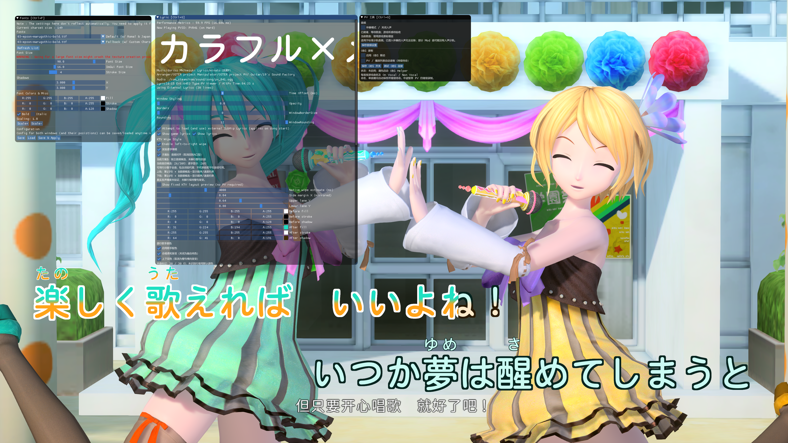

# DivaKaraoke

为《初音未来 Project DIVA Mega Mix+》提供双轨卡拉 OK 歌词、日文注音、歌手配色，以及伴奏与 OBS 录制辅助。

**当前版本：[v0.2.0](https://github.com/HYDlink/DivaKaraoke/releases/tag/v0.2.0)** · [下载安装包](https://github.com/HYDlink/DivaKaraoke/releases/download/v0.2.0/DivaKaraoke-v0.2.0-win64.zip) · [安装与升级](docs/INSTALL.md)

## 效果预览

*双轨歌词、渐变染色、不同歌手颜色，以及可即时调节的 ImGui 面板。[点击查看 4K 原图](docs/assets/divakaraoke-preview.png)，可看清面板细节。*

**完整视频：** [【ニコカラ】【4K】歌姬计划 カラフル×メロディ Colorful Melody](https://www.bilibili.com/video/BV1VTJe6NEqU)

视频展示歌词和歌手配色效果，不包含工具操作教程。

> 截图来自开发环境。v0.2.0 提供整句渐变、双轨布局、注音与歌手配色；图中面板的“实验逐字填唱”与“方案 B：音频对齐”选项属于后续实验，未包含在本次发布中。

## 功能

- **双轨 KTV 歌词**：交替显示当前句与下一句，按整句时间渐进染色，支持间奏预告。
- **日文注音**：在歌词上方显示 Ruby 读音，并随分辨率调整显示比例。
- **歌手配色**：按行区分歌手，支持合唱渐变与人工修订歌手标记。
- **字体与样式**：通过 ImGui 调节字体、字号、描边、阴影和颜色，保留外挂 SRT 支持。
- **伴奏与录制辅助**：支持曲目的伴奏控制，以及通过独立 OBS Helper 自动录制。
- **离线工具**：从本机已有游戏资料生成歌词、注音与歌手旁路，保护用户自行修改的数据。

## 快速开始

1. 安装 [DivaModLoader](https://github.com/blueskythlikesclouds/DivaModLoader) 和 Microsoft Visual C++ 2015–2022 x64 运行库。
2. 从 [Releases](https://github.com/HYDlink/DivaKaraoke/releases) 下载安装 ZIP，将其中的 `DivaKaraoke` 目录放入游戏 `mods` 目录；存在 `priority` 白名单时加入 `DivaKaraoke`。
3. 迁移自己的歌词缓存和配置，或按[安装说明](docs/INSTALL.md)从自己的游戏资料生成。公开包附带开放许可证日文字体及工具依赖，不预置游戏派生歌词缓存。
4. 升级自 MMFreeLyrics 时保留旧目录和配置作为备份；两者同时启用尚未完成兼容验证，建议每套游戏配置只启用一个，详见[共存说明](docs/INSTALL.md#与-mmfreelyrics-共存)。

游戏 DLL 无需 Python。离线导出和 OBS Helper 需要 Python 3.11 或更新版本。OBS 功能还需配置自己本机的 OBS WebSocket 服务。

| 快捷键 | 功能 |
| --- | --- |
| Ctrl+F | 字体设置 |
| Ctrl+G | 歌词、歌手颜色及辅助工具 |
| Ctrl+S / Ctrl+L | 保存 / 读取设置 |

## 使用说明

- [安装、升级与新电脑准备](docs/INSTALL.md)
- [歌手配色与人工标记](docs/SINGER_EXPORT_WORKFLOW.md)
- [伴奏支持范围](docs/NON_VOCAL_SUPPORT.md)
- [OBS 连接与录制](docs/OBS_CONNECTOR.md)
- [从源码构建](docs/BUILD.md)
- [v0.2.0 发布说明与验证记录](docs/RELEASE_V020.md)
- [授权与资源范围](LICENSING.md) · [第三方声明](THIRD_PARTY_NOTICES.md)

v0.2.0 使用整句时间推进。歌手活动只作为声部推测，剧情中的无声口型、缺少动作等情况仍需人工校对；伴奏功能受曲目原始声道结构限制。没有外部时间线时保留原生当前句回退。具体边界见对应功能文档。

## 来源与署名

本项目独立维护于 [HYDlink/DivaKaraoke](https://github.com/HYDlink/DivaKaraoke)，基于 [mos9527/MMFreeLyrics](https://github.com/mos9527/MMFreeLyrics) 开发，上游基线提交为 `86ca9825bba1e3c6a84a48d05768de4d57288c18`。保留上游 Git 历史，感谢 mos9527 的原始开发及对源码、二进制修改和再分发的明确授权。

第三方依赖、字体、歌曲及游戏资源各自保留权利，授权范围见 [LICENSING.md](LICENSING.md)。本项目并非 SEGA、Crypton 或原 MMFreeLyrics 作者的官方产品。

历史开发与研究文档保留于 `docs`。其中的本机路径和旧名称用于记录历史；当前安装与构建以本 README 链接的说明为准。
