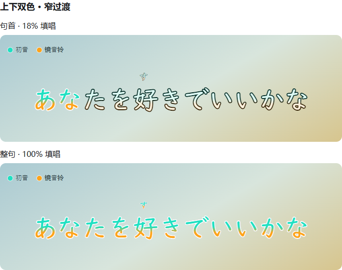
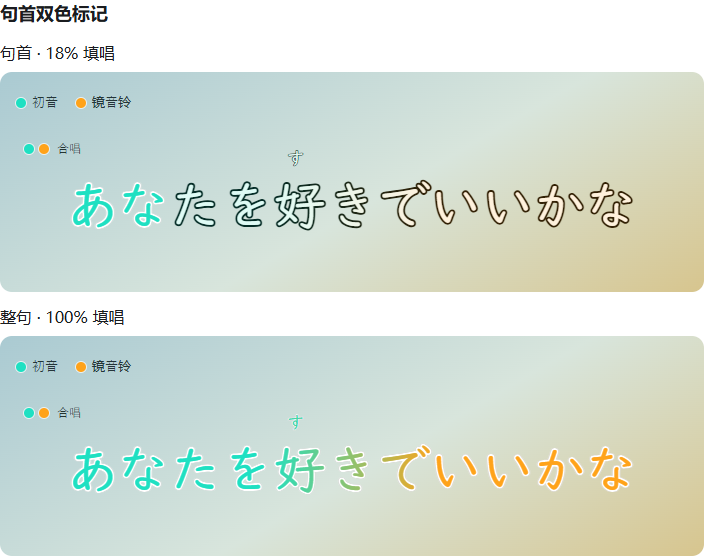
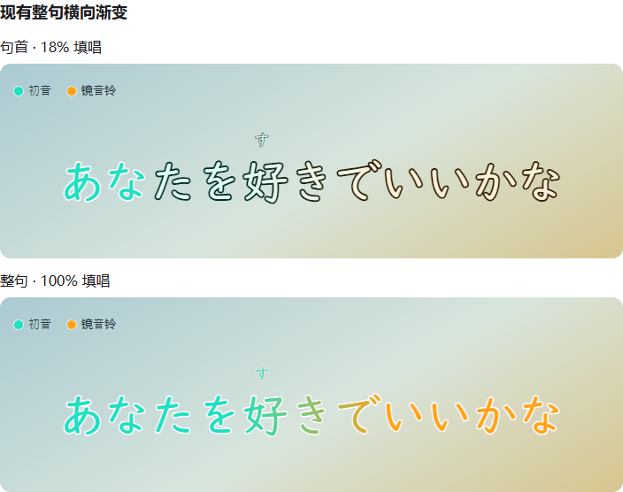

> 历史研发资料，仅供追溯，不是当前操作指南。设备绝对路径已去标识；原始记录保留在私有历史备份及 Git 历史。

# 合唱颜色方案记录

2026-10-14 用户选择与约束：上下双色只是功能性试用，用户评价为「丑但是功能性好」，不作为最终视觉定案。保留三个方案，后续很可能改用方案二。下列图片是设计预览，使用模拟背景与系统字体，不是游戏截图。

## 方案一：上下双色，中间窄过渡

每个字上方为组合中的第一歌手颜色，下方为第二歌手颜色，中间20%柔和过渡。句首即可识别双人；横向填唱仍表示歌词进度。当前作为默认试用样式，正文与每段注音各自按真实字形高度取色。第三歌手及更多组合按同一纵向规则扩展，但人多时条带变细，不认为视觉已经定案。

## 方案二：句首组合颜色标记

保留整句横向渐变，增加所有参与者的颜色提示。用户表示未来很可能转向此方案，但原预览位置已有准备唱歌的预热省略号，当前不可占用。后续须重新设计不会与省略号、正文、注音或安全边距冲突的位置，再进行预览评审；当前没有实现颜色标记。

## 方案三：整句横向渐变

原MVP样式，开始只有第一歌手色，末端为另一位歌手色；用户反馈必须读到后半句才看出合唱，因此作为可切回的基线保留。

## 当前切换与实现边界

Lyric颜色面板勾选「合唱柔和渐变」后，「上下双色」开启为方案一，取消为方案三；关闭柔和渐变为原有融合纯色。保存歌手配色将方向保存在独立 singer-colors.toml 的 chorus_vertical，已有各歌手完整四色和阴影不变。不存在可用的方案二按钮，避免把预览当成已实现功能。

上下色带通过现有ImGui精细裁剪分割字形并自动插值UV，四个分段近似中间的柔和过渡；不重建字体、不加shader、不修改歌词时间或口型标记。预热省略号位置保持原样。
